<p align="center">
  
</p>

<p align="center">
  <b>Android launcher with large tiles, dialler, messages and contacts in one app.</b>
</p>

<p align="center">
  <a href="https://github.com/timkicker/hometiles/actions/workflows/ci.yml">
    
  </a>
  <a href="https://f-droid.org/en/packages/dev.kicker.hometiles/">
    
  </a>
  <a href="LICENSE">
    
  </a>
  
  
</p>

<p align="center">
  <a href="https://f-droid.org/en/packages/dev.kicker.hometiles/">
    
  </a>
</p>

HomeTiles is a free replacement for BIG Launcher, whose features are now spread over three paid apps. It is built on a Unihertz Jelly 2 (3 inches, 349 x 597 dp) and needs no account and no internet permission.

## Contents
- [Screenshots](#screenshots)
- [Themes](#themes)
- [Features](#features)
- [Install](#install)
- [Build](#build)
- [Permissions](#permissions)
- [Contributing](#contributing)
- [License and credits](#license-and-credits)

## Screenshots

<p align="center">
  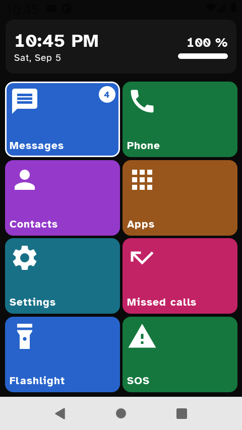
  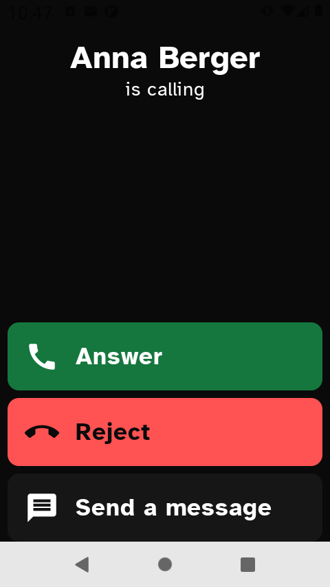
  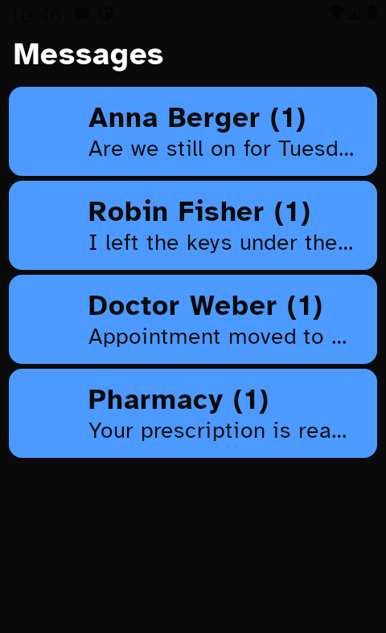
</p>
<p align="center">
  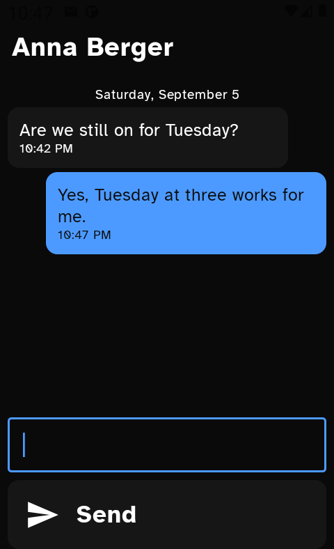
  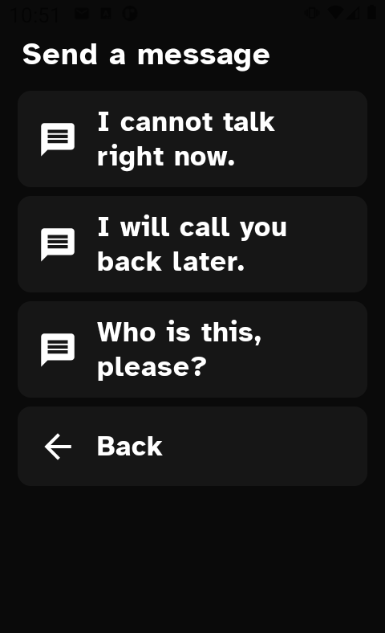
  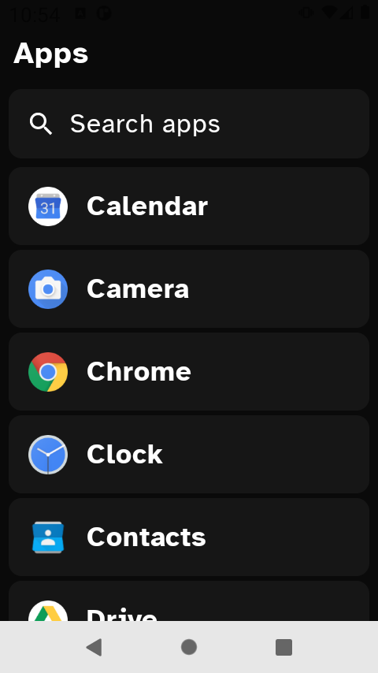
</p>
<p align="center">
  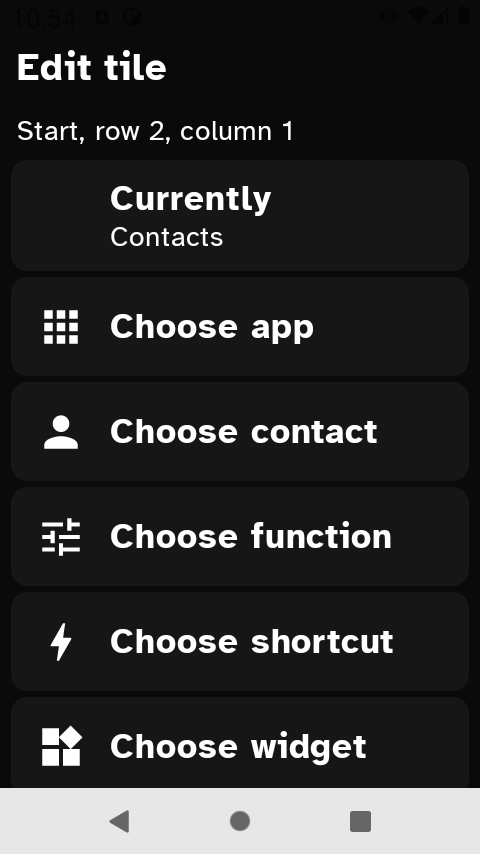
  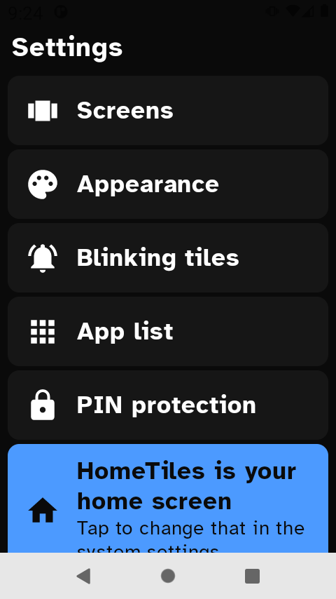
  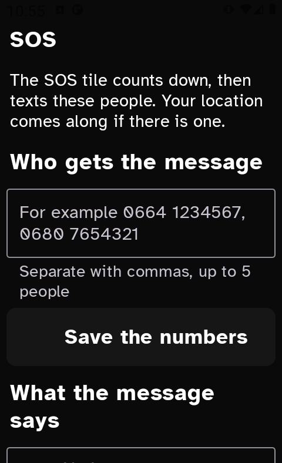
</p>

## Themes

| Dark | Light | High contrast | Paper (e-ink) |
| :---: | :---: | :---: | :---: |
| 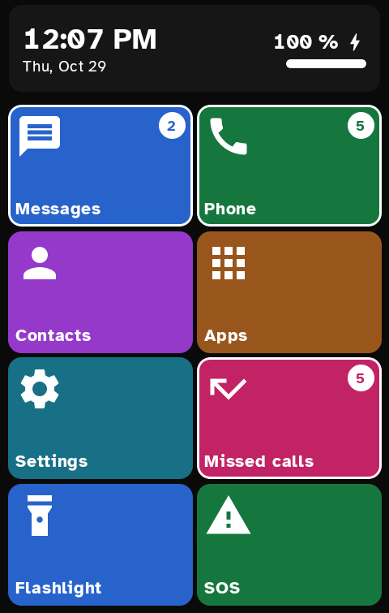 | 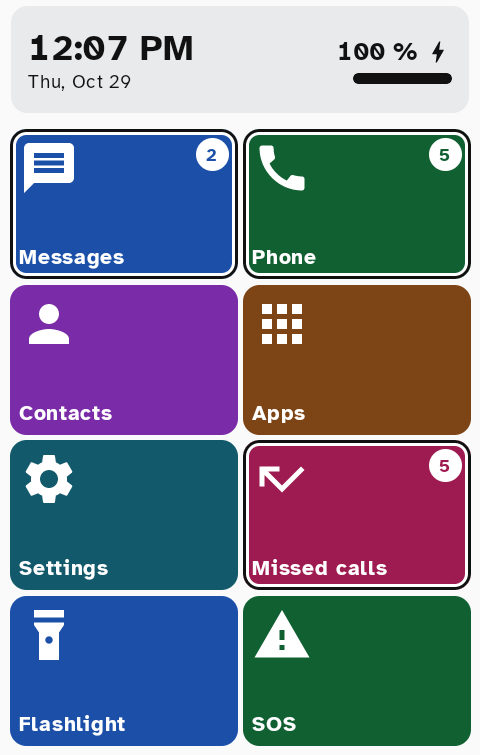 | 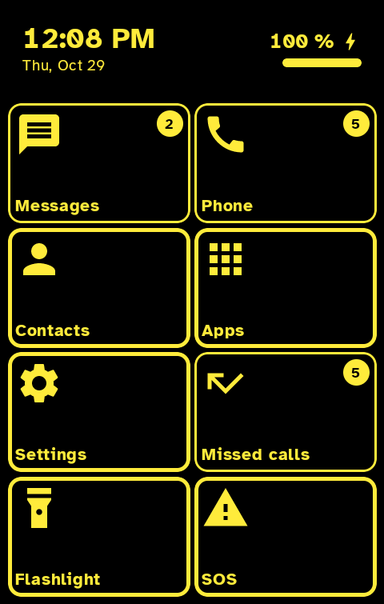 | 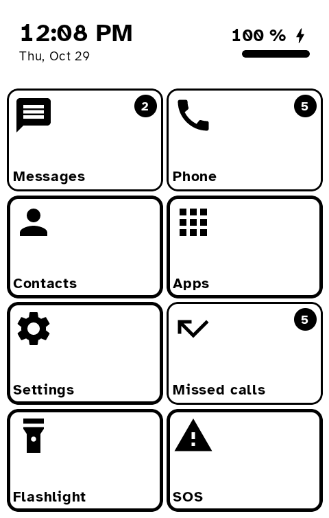 |

A fifth setting follows the phone and switches between Dark and Light. Every colour pair reaches at least 4.5:1, checked by a rule for every combination the app can draw.

## Features

- **Home screen:** a grid of large tiles, each one an app, contact, shortcut, widget, function or another screen. Grid, tile size, colours and labels are settings. Optional header with clock, date and battery.
- **Phone:** keypad, speed dial on 2 to 9, grouped call log and its own call screen. Turn a call down with a short message. The screen goes off at the ear. Emergency numbers always go to the system dialler.
- **Messages:** threads, writing and delivery receipts. Picture messages already on the phone are shown. HomeTiles can be the default SMS app.
- **Contacts:** search that ignores accents and case, sorting by first or last name, favourites.
- **App list:** search, recently used, hidden apps.
- **SOS:** a countdown, then a message to up to five people with the location. HomeTiles never dials by itself.
- **Reading help:** hold a tile to hear it or see it large, page buttons instead of swiping, Atkinson Hyperlegible as the default typeface.
- **Phones with keys:** every screen works with a keypad.
- **Safety net:** if the launcher crashes twice while starting, a plain screen offers the system phone and contacts apps.
- **Backup:** the whole setup exports to a file and reads back on the next phone.
- **Languages:** English, German, Spanish, French, Italian.

## Install

Get it from [F-Droid](https://f-droid.org/en/packages/dev.kicker.hometiles/). Android 8 (API 26) or newer. F-Droid builds and signs the app itself, so the GitHub releases carry no APK.

**If messages stop arriving:** some phones have an app blocker that stops HomeTiles from receiving SMS. Android then deletes them. On the Unihertz Jelly 2: Settings > Smart Assist > App blocker > HomeTiles, start blocker on "No restrictions" (seen in October 2026). For other brands see [dontkillmyapp.com](https://dontkillmyapp.com/).

## Build

```sh
source ./env.sh          # sets ANDROID_HOME, JAVA_HOME and the gradle path
./gradlew assembleDebug
./gradlew test
```

Needs the Android SDK (compileSdk 35) and JDK 21. Modules: `:app`, `:core:model`, `:core:data`, `:core:system`, `:core:ui`.

Most tests are rules that read the source: every permission must be used, colour pairs are computed, text must fit the smallest screen.

**Reproducible:** two builds with `./gradlew --no-build-cache clean assembleRelease` give the same unsigned APK. Checked on 29 October 2026 with AGP 8.7.3, Gradle 8.11.1 and JDK 21:

```
e0574dfc37ae6ba2fc1cf1825af55993499405ca616225a5b00a2937533c6d52   1 972 447 bytes
```

for **Commit `71c5ba6`**. `tools/rebuild.sh` builds twice and compares.

## Permissions

All optional, asked for only when a feature needs them.

| Permission | What for |
| --- | --- |
| `CALL_PHONE` | calling from speed dial, contacts and SOS |
| `READ_CALL_LOG`, `WRITE_CALL_LOG` | showing and deleting the call log |
| `READ_CONTACTS`, `WRITE_CONTACTS` | contacts and the favourite mark |
| `SEND_SMS`, `READ_SMS`, `RECEIVE_SMS` | messages |
| `READ_PHONE_STATE` | the signal bars |
| `ACCESS_FINE_LOCATION`, `ACCESS_COARSE_LOCATION` | the location in an emergency message |
| `POST_NOTIFICATIONS` | showing a new message and an incoming call |
| `USE_FULL_SCREEN_INTENT` | an incoming call on a sleeping screen |
| `VIBRATE` | feedback on a press |
| `WAKE_LOCK` | the screen off at the ear during a call |

No `INTERNET` and no `QUERY_ALL_PACKAGES`.

## Contributing

Focused pull requests are welcome. Kotlin and Compose, no new dependency without a reason. New behaviour comes with a rule that fails without it.

## License and credits

HomeTiles is free software: you can redistribute it and/or modify it under the terms of the GNU General Public License as published by the Free Software Foundation, either version 3 of the License, or (at your option) any later version.

HomeTiles is distributed in the hope that it will be useful, but WITHOUT ANY WARRANTY; without even the implied warranty of MERCHANTABILITY or FITNESS FOR A PARTICULAR PURPOSE. See the GNU General Public License for more details.

You should have received a copy of the GNU General Public License along with this program. If not, see <https://www.gnu.org/licenses/>.

- License: [GPL-3.0-or-later](LICENSE)
- Typeface: **Atkinson Hyperlegible** by the Braille Institute of America, SIL Open Font License 1.1, see [LICENSE-Atkinson-Hyperlegible.txt](LICENSE-Atkinson-Hyperlegible.txt)
- Libraries: [Jetpack Compose](https://developer.android.com/jetpack/compose), [Coil](https://coil-kt.github.io/coil/), [kotlinx.serialization](https://github.com/Kotlin/kotlinx.serialization), [AndroidX](https://developer.android.com/jetpack/androidx)
